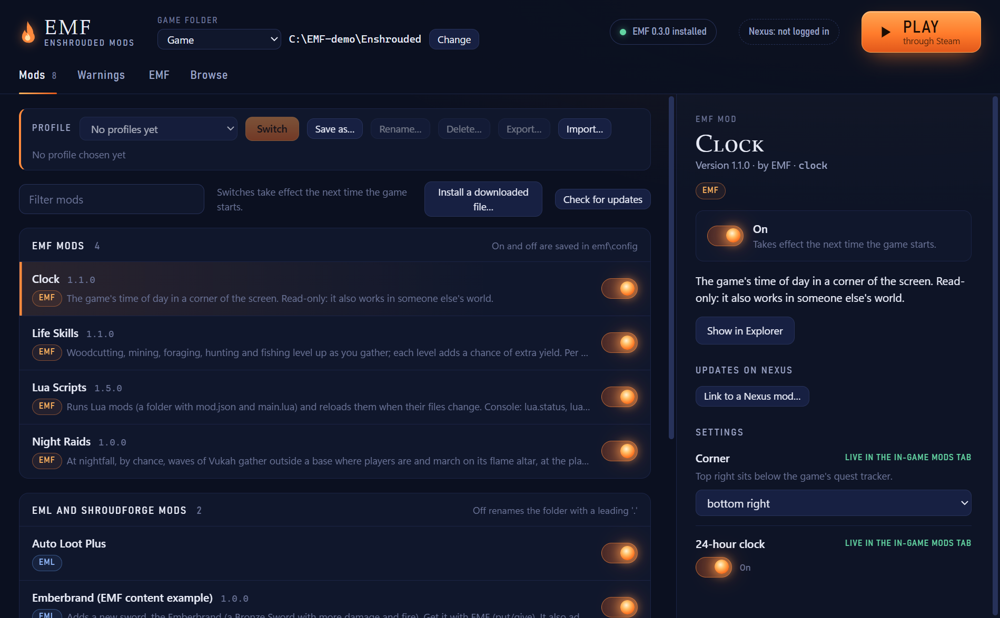
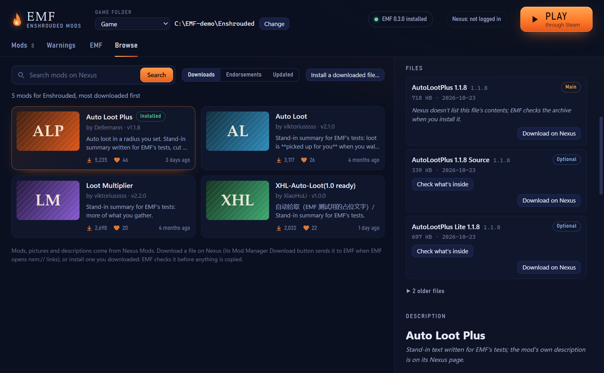
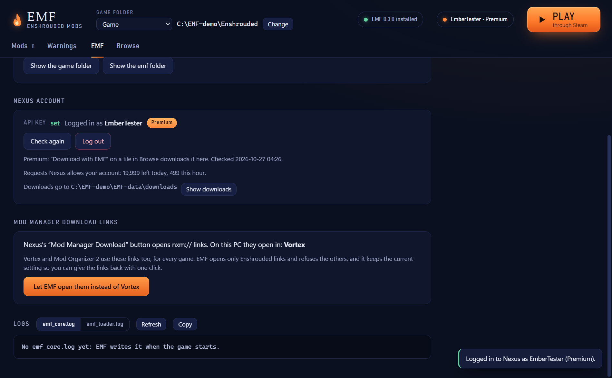

# EMF.exe: the mod manager



EMF.exe is a small Windows program that shows everything installed in an Enshrouded folder. With the game closed it
switches mods on and off, so it can also rescue a setup where a mod stops the game from starting. Settings can be saved
at any time and apply at the next game start; the in-game Mods tab changes them live. "Install a downloaded file"
installs an archive the player downloaded, so that EMF can uninstall it again. It also manages dedicated servers: their
mods, settings, who may use chat commands, EMF itself, starting and stopping them, and their logs ("Servers" below).
Its Saves tab backs up the game's saves and restores them ("Saves" below).

EMF.exe also has Nexus features that use Nexus's API. Its Browse tab shows the mods on Nexus Mods and what each file
would do in this folder. With the player's Nexus account it downloads files itself: from the website's "Mod Manager
Download" button (nxm:// links, once the player lets EMF open them) and, for Premium members, from a "Download with
EMF" button on each file. **Check for updates** asks Nexus, on a click, which installed mods have a newer file, and
updates them through the same plan. The release build does not contact Nexus Mods: the Browse tab, update checks and
account features are switched off, and a tester setting switches them on ("Nexus Mods" below).

## What it shows

- **Mods**, grouped by who loads them:
  - **EMF mods**: `emf\mods\<folder>\mod.json` and loose `emf\mods\*.dll`;
  - **EML and ShroudForge mods**: `mods\<folder>\mod.json` and `mods\*.zip`;
  - **DLL mods started by EMF**: the lines of `dinput8-chain.ini` that count for EMF's loader (before any section
    and in `[Chain]`; other sections are another tool's), with how each did at the last game start
    (`emf\chain_status.txt`). DLLs the installer renamed (`emf\moved.txt`) that the file does not list are shown
    too: "kept aside" when the same tool already runs through another proxy name (`same-loader` in
    `known_tools.txt`), otherwise "not listed";
  - **other loaders and their mods**: the tool behind each proxy DLL next to the game (`known_tools.txt`), Greeneye
    mods (`greeneye\<mod>\mod.json`), Shroudtopia mods (`shroudtopia.json`, DLLs in `mods\`) and ModLoader Proxy's
    list (the `[Load]` section of `chainloader.ini`).
- **Details** of the chosen mod: name, version, authors, description, who loads it, what it needs, its README, its
  settings (controls from the `mod.json` setting types: switches, number boxes and sliders with their steps, lists,
  colour pickers, key binds that take the next key press, text with its length limit; under their `group` headings,
  in the in-game Mods tab's order, and greyed out with the reason while their `enabledWhen` does not hold) and its
  Nexus page (`nexus_id`; it opens in the browser).
- **Will not load**: an EMF mod that is switched on but that EMF's core would not load says why, from the core's own
  rules (`mod_order.cpp` and the switches in `mods.cpp`): a dependency missing or outside its version range (too old
  or too new), a newer EMF API, a dependency cycle, an id taken twice, a dependency or a Lua mod's script host (`lua`)
  that is switched off. An optional dependency that is missing or off is no reason.
- **Warnings**: EMF not installed, a broken `mod.json`, a missing DLL, a mod that will not load, a chained DLL that did
  not start, an EML folder without `mod.json` (EML stops the game at start until it is fixed or switched off), EML mods
  with no EML or ShroudForge to load them, a loader whose file name another tool took, and EMF's start-up report (the
  same lines as `emf_core.log`). **Copy all** puts them on the clipboard for a bug report.
- **EMF**: whether EMF is installed in the folder, its version, the **Nexus account** and the **Mod Manager Download
  links** setting (with the Nexus features, below), and the end of `emf_core.log` and `emf_loader.log` (read while the
  game writes them), each with a **Copy** button. Error texts in a mod's details have one too. The chip at the top
  ("Nexus: not logged in", or the account's name and Premium) opens the account.
- **Play** starts the game through Steam (`steam://rungameid/1203620`).
- **Profiles**: the on/off state of every mod under a name, above the list (below).
- **Browse**: Enshrouded mods on Nexus Mods (with the Nexus features, below).
- **Server** (a dedicated server's folder only): its config, EMF's chat commands, Start and Stop, EMF in it and its
  logs ("Servers" below).

A mod whose `mod.json` cannot be read is still listed, with the error.

## What a switch does

Every switch takes effect at the next game start, and nothing is ever deleted.

| Mod | Off means |
|---|---|
| EMF mod | `enabled=0` in `emf\config\<id>.ini`, section `[<id>]` (what EMF's core reads) |
| EML mod | its folder or zip in `mods\` is renamed with a leading `.` (`mods\foo` becomes `mods\.foo`); EML skips those |
| DLL mod started by EMF | its line in `dinput8-chain.ini` gets `; ` in front; every other byte of the file stays, and a UTF-16 file stays UTF-16 |
| ShroudForge package, when ShroudForge is the active loader | read-only here: switch it in ShroudForge (F9). ShroudForge is not the active loader when its `shroudforge\config\modloader-config.json` says `"modloader": "eml"`, and it ignores zip mods, which keep EML's rule |
| other loaders' mods | read-only: their own loader manages them |

While `enshrouded.exe` or `enshrouded_server.exe` runs from the folder, the switches are locked ("close the game
first"), and the banner says which process (or that Windows hides its folder because the game runs as administrator;
then EMF assumes it is this folder). Settings still save; the running game uses them from its next start, and each
setting says "From next start" then (the in-game Mods tab changes them at once: "Live in the in-game Mods tab").
Settings are checked the same way as in the game: a value outside the mod's range is refused with the reason.

## Profiles

A profile is the on/off state of every mod under a name ("Vanilla+", "Building", "Testing"), to switch between setups
in one click. The picker above the mod list shows the current profile (the one last saved or switched to), or
"(changed)" when a mod it lists is switched another way now.

- **Save as...** saves the state of every mod in the list: EMF and Lua mods, EML mods and DLL mods in
  `dinput8-chain.ini` (a loader EMF starts from that file, such as EML as `eml.dll`, is a chain entry like any other
  and is switched). ShroudForge's packages (when it is the active loader), other loaders' mods and DLLs the installer
  kept aside are recorded as read-only: a profile never switches those, also when EMF could switch them later (ShroudForge
  handing `mods\` to EML, say). Left out: the proxy DLLs of other loaders next to the game (not mods), and mods whose
  state is not a switch (a `mod.json` EMF cannot read, so EMF does not load the mod; an EML folder without `mod.json`,
  which EML does not take as a mod). Two copies of one EML mod (`mods\foo` and `mods\.foo`) count as one, on when EML
  loads one. **Include settings** also saves each EMF mod's settings (off by default). A name has 1 to 40 characters
  and none of `\ / : * ? " < > |`. When another profile has the same file name ("Vanilla" and "Vanilla+"), EMF asks
  before it replaces it.
- **Switch** sets each mod the profile lists to its state, then says what it did. Like the switches, it is locked while
  the game or a server runs from the folder, and everything takes effect at the next game start. Each change goes
  through the same switch as a click in the list (the table above): the ini, the rename, the chain line in the file's
  own encoding. It runs in the background ("Switching..."); until it is done the list's switches and Save as wait.
  When `dinput8-chain.ini` is there but cannot be read (another program holds it), Switch and Save as stop and say so
  instead of taking it as empty.
  - A mod the profile lists that is not in the folder is reported, with its Nexus id when the profile knows it. It is
    never fatal: the others still switch.
  - A read-only mod in another state is reported and left as it is, and so is an entry the profile recorded as
    read-only.
  - A mod in the folder that the profile does not list (installed since) stays as it is and is reported as "not in
    this profile"; it does not make the picker say "(changed)".
  - When one switch fails (a file in use, two copies of a mod), the others are still made and the failure is
    reported. Nothing is rolled back.
  - With settings, they are set after the switches. Values are compared as EMF stores them ("true" is 1, "15.0" is 15),
    so a hand-written profile does not stay "(changed)". A value the mod no longer accepts, or a setting it no longer
    has, is reported.
- **Rename...** and **Delete...**: Delete removes only the profile's file, never a mod.
- **Export...** saves the profile as a `.json` file, to share a modlist. **Import...** reads one, shows which of its
  mods this folder lacks (with their Nexus ids where it has them) and what Switch would do here (the mods it would
  switch on and off, the settings it would set), and adds it to the list under a name you choose, asking before it
  replaces one. Importing switches nothing.

The files are `emf\profiles\<slug>.json`, where the slug is the name in lower-case letters and digits ("Vanilla+" ->
`vanilla.json`, "Building 2" -> `building-2.json`; a name with letters outside ASCII gets a short hash of the whole name
after that, so "Строительство 1" and "Выживание 1" stay two profiles) with the display name inside, and
`emf\profiles\current.txt`, which names the current one:

```json
{
  "emf_profile": 1,
  "name": "Vanilla+",
  "created": "2026-10-26 20:00",
  "emf_version": "0.3.0",
  "mods": [
    {"source": "emf", "id": "clock", "on": true, "name": "Clock", "nexus_id": "1234"},
    {"source": "eml", "id": "auto-loot-plus", "on": false, "name": "Auto Loot Plus", "nexus_id": "170"},
    {"source": "chain", "id": "creative.dll", "on": true},
    {"source": "eml", "id": "sf-package", "on": true, "read_only": true}
  ],
  "settings": {"clock": {"place": "1", "h24": "1"}}
}
```

`source` and `id` are as the list has them (EML: the folder or zip name without the `.`; chain: the DLL's name).
`settings` is there only when the profile includes them. A file EMF cannot use (not JSON, a mod listed twice, a bad
name, over 1 MB, more than 2000 mods or 5000 settings, a text that is too long or has control characters, made by a
newer EMF) is listed as not usable, with the reason, and can be deleted; so can any other `.json` in the folder. Uninstalling EMF
keeps `emf\profiles`, like the settings (`uninstall.cmd -All` removes them too).

In the game, the console's `profile` command and the picker at the top of the in-game Mods tab do the same with the
same files ([README_EMF.md](../README_EMF.md), "In-game console"). There a switch also applies at the next game start.
The work runs on a thread of its own, never on the game's render or world threads; EMF mods' switches and a profile's
settings go through the live settings, so the Mods tab shows them at once and mods hear about them. On a dedicated
server (and in a game you host with `[chat] players=1`), players allowed to run EMF's commands from the chat (`admins`,
or everyone with `everyone=1`) can run `profile load` too, and so switch the server folder's mods for its next start:
the same power `set <mod> enabled 0` already gives them.

## Nexus Mods: the three modes

Nexus's API policy lets an app meant for the public use the API only when Nexus has registered it, and it lists
personal API keys in a public app as unacceptable. A registered app has an application slug (`kSsoSlug` in
`src/nexus/sso.h`). The release build has none. One mode decides every Nexus feature together (`nexus_mode` in
`app/bridge.h`; the page hears it as the state's `nexus`):

- **Off: the release build** (no slug, no tester switch): EMF.exe makes no Nexus request at all.
  - Hidden: the Browse tab, **Check for updates** (and **Link to a Nexus mod...**, which only feeds it), the account
    card and the Nexus chip, the nxm:// setting, **Download with EMF**. Pictures from the picture hosts are answered
    "blocked".
  - The host refuses those commands too (`nexus_search`, `nexus_mod`, `nexus_file`, `updates_check`, `account_key`,
    `account_check`, `account_logout`, `sso_start`, `nxm_take`, `nexus_download`), and its API clients get a transport
    that refuses, so a page script cannot get round the hidden parts.
  - Everything local stays: the mod list, switches, settings, profiles, warnings, logs, Play, servers, and **Install a
    downloaded file** on the Mods tab, for an archive downloaded from the website (Manual Download on a file's page),
    with its plan, backups and uninstall. A mod's Nexus page still opens in the browser: that is the website, not the
    API.
  - A key a testing build stored (`nexus.key`) is neither read nor deleted.
  - When a testing build made EMF the nxm:// handler, a link from the website's Mod Manager Download button is answered
    with what to do instead (Manual Download, then Install a downloaded file). The EMF tab then shows only the **Mod
    Manager Download links** card, to give the links back; uninstalling EMF gives them back too.
- **Personal key: the testing build** (the tester switch, no slug): every Nexus feature, with a pasted personal API
  key, which Nexus allows for testing. Nexus reviews an app in this mode. The switch is one line in EMF.exe's settings
  file, `%LOCALAPPDATA%\EMF\app.ini`:

  ```ini
  [nexus]
  personal_key=1
  ```

  EMF.exe reads it when it starts, so an EMF.exe that Windows starts for an nxm:// link sees it too. To add it from
  PowerShell (EMF.exe makes the folder when it first runs; this makes it if needed):

  ```powershell
  New-Item -ItemType Directory -Force "$env:LOCALAPPDATA\EMF" | Out-Null
  Add-Content -Path "$env:LOCALAPPDATA\EMF\app.ini" -Value "[nexus]`r`npersonal_key=1"
  ```

  To turn it off, remove the two lines (or set `personal_key=0`). Restart EMF.exe after either change.
- **SSO: a build with a slug** in `kSsoSlug`: every Nexus feature, with **Log in with Nexus** in place of the key
  field. The tester switch then only adds the key field next to it, for developers.

## Browse



- **Search** by name (Nexus matches whole words: "loot" finds "Auto Loot Plus"), **sort** by downloads, endorsements or
  last update, 20 mods a page. Each card shows the picture, name, author, version, downloads, endorsements, when it was
  updated, and **Installed** when the folder has it: a `mod.json` with that `nexus_id`, or an install EMF.exe recorded.
  Adult mods get an 18+ badge and a blurred picture.
- **A mod's page** (click a card): the picture, author, version, numbers, **Open on Nexus** (the mod's Files tab in the
  default browser), **Install a downloaded file...**, the files and the description.
- **Files**: MAIN and OPTIONAL first, then updates and miscellaneous files, then old versions, archived and removed
  files, folded under "N older files". For each MAIN and OPTIONAL file (six at most) EMF asks Nexus for the paths in its
  archive and runs the classifier (`src/nexus/classify.h`) against this folder: what the file is (EMF mod, EML mod, DLL
  mod named `dinput8.dll`, another loader, ReShade preset, save files, ...), the other layouts in it ("also EML mod"),
  and plain notes such as clashes with what is installed. Older files are looked at when the player clicks **Check
  what's inside**. Nexus has no listing for many new uploads; such a file says "Nexus doesn't list this file's contents;
  EMF checks the archive when you install it".
- **The description** is Nexus's BBCode turned into HTML by `src/nexus/bbcode.h` (all text escaped, http(s) links only,
  pictures only from the hosts below, checked inline styles). The page puts it only into its own container; its links
  open in the default browser.

Only MAIN files are looked inside automatically (at most two listings), so opening a mod costs about six Nexus
requests (the mod, its files, a couple of listings); other files are classified when the player clicks **Check what's
inside**. A mod's page is cached for the session, so going back to it makes no new requests. Every Nexus request is made
by EMF.exe on a worker thread (`BridgeHost::run_async`), never by the page, and only when the player does something:
opening the tab (the first search), searching, changing the sort or page, opening a mod, asking about an older file. A
newer search cancels the one still running (the client's cancel flag), and an answer to an older request is dropped
(each carries an id). The page shows a loading state and errors as text, with **Try again**.
The client's rules (EMF's `Application-Name`/`Application-Version` headers, timeouts, pages) are in `docs/nexus.md`.

## Install a downloaded file

On the Mods tab (in every build) and on the Browse page, for a file downloaded by hand. (A file EMF downloads itself, below, goes
through the same steps from step 2.)

1. **Choose the file**: a `.zip`, `.7z` or `.rar` (the dialog opens in Downloads).
2. **EMF unpacks it** with Windows' own `C:\Windows\System32\tar.exe` (libarchive) into a new folder
   `%TEMP%\emf-install\<n>`. Nothing from the archive is ever run; tar runs from System32 (not a folder with the
   archive's files) in a job that is killed if EMF.exe exits. A `.zip`, `.7z` or `.rar` must start with that type's magic
   bytes, so a tar or an mtree spec wearing a `.zip` name (which libarchive would otherwise read, mtree even pulling file
   contents from disk paths) is refused. The archive is refused when tar's listing has a path with `..`, an absolute
   path or a drive, a stream, a device name (CON, NUL, ...), a name ending in a dot or a space, a link or a device, or
   more than 50,000 entries or 2 GB; the unpacked folder is walked again without following links (a symbolic link,
   junction or hard link refuses it) and watched while tar runs (above 2 GB tar is stopped). Paths are checked with
   `nexus::unsafe_archive_path`, the classifier's own check, and all file work uses `\\?\` long paths. When Windows'
   tar cannot read the archive's file names (non-Latin characters) EMF says so and asks the player to unpack it by
   hand.
3. **The plan**: the files are classified with the same classifier as the Nexus listing, the real `mod.json` files are
   read, and a sheet shows **what goes where**, part by part, with the classifier's notes. Nothing is copied yet.
4. **Install** copies the files. **Cancel** deletes the unpacked folder.

| What the archive holds | Where it goes |
|---|---|
| EML mod, ShroudForge mod (`mods/<id>/` with `mod.json` and `src/mod.lua`) | `mods\<id>\` |
| EMF mod (`emf/mods/<id>/`, or `<id>/mod.json` with `main.lua`) | `emf\mods\<id>\`, named by the `id` in its `mod.json`, which must be one EMF reads (`core::parse_manifest`); a newer `emf` API than this EMF.exe knows is a note |
| a DLL mod with `dinput8.dll` at the top | `dinput8.dll` is renamed as EMF's installer does: `<tool>.dll` when `known_tools.txt` knows its DLL, else its version information's product (Microsoft's names skipped), else the archive's name without Nexus's numbers (`AutoLootPlus 1.1.8-170-1-1-8-1792790875.zip` gives `autolootplus.dll`), else `dinput8-previous.dll`; `-2`, `-3` when the name is taken. The new name is added inside `[Chain]` of `dinput8-chain.ini` (the installer's Add-ChainEntry rules, the file's own encoding and line breaks), and older listed copies of the same known tool are switched off (`; `). Its other files are copied with their paths. EMF must be installed in the folder |
| another proxy DLL at the top (`dbghelp.dll`, `winmm.dll`, ...) and a loader's files | copied only where nothing is |
| Greeneye mod (`greeneye/<id>/`) | `greeneye\<id>\`, with the Greeneye Loader's `dbgcore.dll` when it ships one and the folder has none |
| Shroudtopia mod (`mods/<id>/` with a DLL) | `mods\<id>\` |
| EMF itself, a ReShade preset, save files, a Cheat Engine table, files EMF cannot place | explained, not installed |

- **An archive only writes a mod's own folders.** A loose file under `emf\` is refused unless it is inside an
  `emf\mods\<id>\` folder for an EMF mod the archive actually contains, and `dinput8-chain.ini`, `chainloader.ini`,
  `enshrouded*.exe`/`.dat`, `*.kfc*` and the game's own DLLs (`steam_api64.dll`, `GFSDK_*`, `nvngx_*`) are refused
  anywhere. So an archive cannot plant a forged install record, EMF's own files or a file the game loads by name; the
  rest of the archive still installs.
- **A renamed `dinput8.dll` never takes a reserved name.** The chosen `<base>.dll` is never a loader's proxy name or a
  DLL that Windows ships in System32 (`dxgi`, `winmm`, `version`, `d3d11`, ...); `-mod` is appended until it is free, so
  the game never loads the renamed mod as a system DLL.
- **One archive, several parts**: Auto Loot Plus is a `dinput8.dll` DLL mod and an EML mod; each part installs on its
  own, and a part that cannot install does not stop the others. Files next to an EML or EMF mod folder that belong to
  no part (a README at the top) are not copied; the sheet says so.
- **Nothing is ever overwritten.** A part that would replace another mod's file is refused and names the file (and,
  for a proxy DLL, its tool). A read-me of the same name is skipped. A file with the same bytes is left as it is. At
  install time `CopyFile` refuses to overwrite as well, so a file that appeared since the plan stops the install.
- **Updates keep your data.** When the mod folder is already there, EMF backs up only the files the new version
  replaces or that the earlier install put there; everything else in the folder (the mod's own saved data, `emf.dir`,
  your edits) stays in place and is carried into the new version. A folder switched off since (`mods\.<id>`) moves to
  `emf\backup\` whole instead. Files of an earlier install with the same key move to `emf\backup\<key>-<time>\`.
  Nothing is deleted. The sheet says which earlier install it replaces, and that your data is kept.
- **While the game runs** (or a dedicated server from the folder) Install and Uninstall are refused: the same check as
  the switches. (EMF's installer refuses to run while EMF.exe runs from the folder, so the two never change it at once.)
- **When something fails** half-way, everything this install did is taken back: its new files are removed, backups move
  back, `dinput8-chain.ini` gets its old bytes. While files are being copied or removed, the window does not close.

**The size cap while unpacking** counts what tar writes as it writes it (Windows keeps that count for the job tar runs
in), so an archive whose header gives no unpacked size (some `.rar` files) is stopped soon after it passes the cap,
not only by the time limit. (A folder listing shows a file that is still being written as 0 bytes.)

**A file two installs share** (a loader DLL such as Greeneye's `dbgcore.dll`, put there by the first install and
found there by the second) stays while either needs it. When the install that put it there is uninstalled first, the
other one takes it over in its record, so whichever goes last removes it. A file that was there before EMF installed
anything is never removed.

## Uninstall and what is recorded

Each install writes `emf\installed_mods\<key>.json`; the key is `nexus-<id>` when the Nexus mod is known (installed from
its page, or `nexus_id` in the archive's `mod.json`), else the mod's id, else the archive's name. It holds the name,
version, Nexus id, archive name and time, the kinds, the mod folders it installed, every file with its SHA-256, the
folders it made, the DLLs it listed in `dinput8-chain.ini` and the older copies it switched off, and its backups.

A file another install still has, or lists as a shared dependency (a loader's `dbgcore.dll` two Greeneye mods share,
a file already there with the same bytes), is recorded as a dependency and is kept on uninstall, named as "also used by
another mod". The record also lists the files it installed outside the mod's own folder, which the uninstall
confirmation shows by name.

A mod EMF installed has **Uninstall** in its details on the Mods tab (with what it will do, to confirm). It removes
exactly the recorded files whose SHA-256 still matches; a file that changed since is left in place and named, and the
game's and EMF's own files are never removed however a record names them (so a forged record cannot delete
`enshrouded.exe`). A record binds to a mod row only through the mod folder or the chain DLL it installed, never through
an arbitrary file path. It removes the folders the install made (and the mod's own folder) once they are empty, takes
its lines out of `dinput8-chain.ini` (a DLL that was left in place keeps its line) and switches the copies it switched
off on again. Backups in `emf\backup\` stay. A record is read with the same path check, so a changed record cannot
reach outside the game folder.

## Nexus account



On the EMF tab, with the Nexus features ("Nexus Mods" above). Downloading through Nexus's API needs the player's own
API key.

- **Personal API key** (the testing build, with the tester switch): **Get your personal API key on nexusmods.com** opens
  `https://www.nexusmods.com/settings/api-keys` in the browser; the player copies the key from "Personal API Key",
  pastes it and clicks **Save key**. EMF checks it with Nexus (`users/validate.json`) and shows the account's name and
  whether it is **Premium**. A key Nexus refuses is not stored, and the card says why. **Check again** asks Nexus once
  more (after buying Premium, say); **Log out** deletes the key from the PC.
- **Log in with Nexus** (single sign-on) appears in a build with an application slug (`kSsoSlug` in
  `src/nexus/sso.h`; it is empty in the release build). It opens Nexus's page in the browser, the player authorises EMF
  there, and the key Nexus sends back is checked and stored like a pasted one. Nexus allows personal keys only for
  testing and pre-release, so with a slug the card shows only **Log in with Nexus** and EMF.exe refuses a pasted key.
  The tester switch ("Nexus Mods" above) keeps the key field next to it, for developers.
- **Where the key is kept**: `%LOCALAPPDATA%\EMF\nexus.key`, encrypted with Windows DPAPI for the current Windows user
  (`CryptProtectData`; another user or another PC cannot read it), together with the account's name, Premium and when it
  was checked, so starting EMF.exe asks Nexus nothing. The account's email (which Nexus's reply carries) is never read.
  The key is never logged and never sent to the page (the page hears only "set" or "not set", the name and Premium); it
  goes only to `api.nexusmods.com`, in the `apikey` header. API requests never follow a redirect, and downloads from
  Nexus's CDN never carry it.
- **Request allowance**: every API reply says how many requests Nexus still allows the account (`X-RL-Daily-Remaining`,
  `X-RL-Hourly-Remaining`); the card shows them. When both are used up EMF asks Nexus nothing more until the reset time
  Nexus gave (`X-RL-Hourly-Reset`; five minutes when there is none), and says when that is.
- **Log out while a check is under way**: the check's answer is dropped, so the key stays out. Log out also cancels a
  download that is using the key.
- **A key file EMF cannot read** (damaged): the card says to paste the key again; one saved by another Windows user
  says so. The file is written to disk before it replaces the old one, and a left-over `nexus.key.tmp` is removed.

## Downloads

- **From a Mod Manager Download link (free and Premium accounts)**: on a file's page on Nexus the button opens an
  `nxm://enshrouded/mods/<mod>/files/<file>?key=...&expires=...&user_id=...` link. When EMF opens these links (below),
  Windows starts `EMF.exe --nxm "<link>"`; when EMF.exe already runs, the new one hands the link to it and exits, and
  the running window comes to the front. EMF asks Nexus for the file's details and its download link with the link's
  key and expiry, and downloads the file. A link for another game, a collection, a link more than five minutes past its
  expiry by the PC's clock (within that, Nexus's own answer decides), or one made for another Nexus account than the
  key's is refused with the reason (the link's key is never shown). A link that arrives before a key is set waits: the
  EMF tab opens on the account, and the download starts once the key works; a second such link is refused with the
  reason, not dropped. Links that come while EMF.exe is still starting are all answered once its page is up.
- **When EMF.exe runs as administrator**, a link from the browser (a normal program) cannot reach it: Windows keeps
  normal programs from sending messages to elevated ones (UIPI). The link then opens in a second, normal EMF.exe.
- **Download with EMF (Premium)**: each file on a mod's Browse page has **Download with EMF** for a Premium account. A
  free account gets **Download on Nexus** instead, which opens the file's page in the browser: Nexus gives free
  accounts downloads only through its website's button (then the link comes back to EMF as above).
- **How**: three requests, only when the player clicks: the file's details (its archive name and exact size), its
  download link, and the file from the first CDN address over HTTPS. Redirects are followed only to `https://`
  addresses. A file that is not a `.zip`, `.7z` or `.rar`, or is larger than the install pipeline's 2 GB, is refused
  before it is fetched; a download whose size differs from Nexus's `size_in_bytes`, or from the CDN's `Content-Length`,
  is stopped and deleted. One download runs at a time; a bar at the bottom shows its progress, with **Cancel**, which
  stops even a download whose connection hangs at once. A failed or cancelled download leaves nothing behind.
- **Where**: `%LOCALAPPDATA%\EMF\downloads\<Nexus's file name>` (a file of the same name is replaced). The files stay
  there after installing (**Show downloads** on the account card opens the folder; they can be deleted at any time).
  A `.part` file older than a day (EMF.exe closed in the middle of a download) is removed at the next download.
- **Then**: the downloaded archive goes through "Install a downloaded file" from step 2: checked unpacking, the plan
  sheet, and **Install** only when the player clicks it. The plan knows the Nexus mod (it wins over the `mod.json` and
  the file name, since EMF downloaded it from that mod) and the file, and the install record keeps the file id
  (`nexus_file_id`). A download's plan never replaces what is on screen: when another sheet (a plan, a question, a
  result) is open, the download bar says **A download is ready** with **Show plan**. A download's plan puts the keyboard
  on Cancel, not Install, and every plan's **Install** ignores clicks and Enter for a second after the sheet appears.

## Mod Manager Download links (nxm://)

Vortex and Mod Organizer 2 use the same `nxm://` links, so EMF never takes them silently. The setting on the EMF tab
says which program opens them now (read from the command Windows runs: `HKCU\Software\Classes\nxm\shell\open\command`,
else the all-users one under HKLM): "Vortex", "Mod Organizer 2", "Nexus Mod Manager", another copy of EMF (with its
path), a program's file name, or nothing.

- **Let EMF open them** first saves what was there in `HKCU\Software\EMF\NxmBackup`: whether the keys `nxm`,
  `nxm\shell`, `nxm\shell\open` and `nxm\shell\open\command` existed, the raw type and bytes of the key's default value,
  its `URL Protocol` and the command, and who had the links (when another program took them since EMF last had them,
  that program's setting is saved instead). A value EMF could not put back exactly (a kind it does not know, or above
  64 KiB) refuses the change, and nothing is written. Then it writes `HKCU\Software\Classes\nxm`: `URL Protocol`, a
  default `URL:NXM Protocol` when there was none, and the command `"<path>\EMF.exe" --nxm "%1"`. Other values and keys
  (another tool's icon) stay. HKLM is never written.
- EMF opens only Enshrouded links. A link for another game is refused, and the message says which program had the links
  before, so the player can give them back.

### How to undo it

**Give them back to Vortex** (or **Stop opening them** when nothing had them) puts the saved values back with their
types and bytes and removes the keys EMF made, or removes EMF's key when there was none (an empty key left in HKCU would
hide an all-users handler; this was checked with the real registry functions on a remapped scratch key, while HKCR's
merged view itself was not tested, since that needs the real HKCU key), and forgets the backup. When another
program has taken the links since, EMF leaves them alone and only forgets its backup. Uninstalling EMF
(`uninstall.cmd`) does the same before it deletes EMF.exe, when that EMF.exe opens the links
(`EMF.exe --release-nxm`). By hand: delete
`HKCU\Software\Classes\nxm` (or set its `shell\open\command` back) and `HKCU\Software\EMF\NxmBackup`, or start
Vortex or Mod Organizer 2 and let it register itself again. Logging out does not change the setting.

`uninstall.cmd` keeps the Nexus key and the downloads (`%LOCALAPPDATA%\EMF\nexus.key`, `%LOCALAPPDATA%\EMF\downloads\`)
and says where they are; `uninstall.cmd -All` removes them, and `HKCU\Software\EMF\NxmBackup` too, unless a copy of EMF
(another game folder's) still opens the links and needs the backup to give them back.

## Servers

EMF.exe also manages an Enshrouded dedicated server (`enshrouded_server.exe`, Steam app 2278520) the way it manages
the game: its mods and their settings, who may use EMF's chat commands, installing EMF and mods there, starting and
stopping it, and its logs.

### Folders

- The list at the top shows **Game** and each server as **Server: <name>** (the `name` in its `enshrouded_server.json`,
  else the folder's name), then **Add a server folder...**. Picking an entry shows that folder.
- **Add a server folder...** offers the servers Steam has (`steamapps\appmanifest_2278520.acf` in any Steam library,
  the folder `steamapps\common\<installdir>`, `EnshroudedServer` by default) with **Add**. A server elsewhere (installed
  with SteamCMD, or copied) is picked with **Choose a folder...**; it must hold `enshrouded_server.exe` (a game folder is
  refused with the reason).
- The list is kept in `%LOCALAPPDATA%\EMF\folders.json`: `{"version": 1, "folders": [{"kind": "game" | "server",
  "path", "stop_on_close"}]}`, the game first, then the servers in the order they were added. A folder shown at start
  (`--game`, an EMF.exe installed in a server folder, **Change**) joins it. A broken file is an empty list.
- A folder name the page sends is added only when Steam has it (or in a test run, `EMF_TEST=1`); any other comes through
  the folder dialog. Taking a server off the list (`folder_forget`) changes nothing in its folder.
- For a server folder the header's Play button says **Server** and opens the Server tab; **Change** is for the game's
  folder.
- A folder reached through a junction, a symbolic link or a subst drive is the same folder (the list, the process).
- The Server tab's files (the config, `[chat]`, the refused accounts of `emf_core.log`, the labels, the process) are read
  on a worker every few seconds and kept, `emf_core.log` only when its size or time changed; the window reads them
  itself only when a folder is first shown or after a change made from the tab, so a sleeping network drive does not
  hold it. The logs are read on a worker too.

### Mods on a server

- The Mods tab is the same as for the game: the list, the switches, the settings, **Install a downloaded file**,
  **Uninstall**, and the same lock while the server runs from the folder.
- Each EMF and EML mod says where it has to run, from `side` in its `mod.json` (`docs/modding/reference.md`):

  | `side` | Note | Row |
  |---|---|---|
  | `"both"` | Its mod.json says players need it too. | "Players need it too" |
  | `"server"` | Its mod.json says it runs on the server; players do not need it. | "Server-side" |
  | `"client"` | Its mod.json says it does nothing on a server. | "Not for servers", and a warning while it is switched on |
  | not given | Players may need this mod too: its mod.json does not say where it runs ("side"). | nothing |

  The notes give the author's word, not EMF's finding. A value EMF does not know is a warning (the mod still loads).
  DLL mods and other loaders' mods get no note: EMF cannot tell. The shipped clock says `client`.
- The plan of an archive installed into a server folder gives each mod's note too, and a client mod is named in its
  notes. It still installs: you decide. Every plan sheet names the folder it installs into.

### The Server tab

- **Server (enshrouded_server.json)**: name, slots, port (`queryPort`; an older server's `gamePort` too), text chat (a
  warning when it is off: players cannot type commands then), and each user group with its password as **set** or
  **none: anyone can join with it** and what it may do. An old single `password` (before update 2) shows as set.
  Read-only; **Show enshrouded_server.json** opens Explorer on it. Passwords never leave the parser
  (`parse_server_config`): the page hears only set or not, the logs EMF shows have them stripped (below), and nothing
  stores them.
- **EMF chat commands** (`[chat]` in `emf\emf_core.ini`, `docs/modding/server.md`):
  - **Every player may use EMF commands** is `everyone` (with "only on a server for friends").
  - **Admins** are account hashes, one per line. Each is checked as the core reads it (1-16 hex digits, `0x` optional;
    a test checks that EMF.exe and the core's `parse_chat_policy` agree): a Steam64 id is refused with the reason, and
    nothing is saved. The saved line (`a, b, ...`) must fit the 2047 characters the core reads (about 100 accounts);
    a longer one is refused with the reason.
  - `[chat]` is read as Windows reads it for the core: the first `[chat]` section only, spaces and one pair of quotes
    around a value dropped (a test compares EMF.exe's reading with `GetPrivateProfileString` on such files).
  - **Save** writes `admins` and `everyone` one key at a time: the file's other keys, its comments and its encoding
    (UTF-16 stays UTF-16) stay, and a missing file is made. `players` is not shown: a dedicated server always takes
    players' commands (`players=1` is for a game you host); a `players` line in the file is kept.
  - **Refused lately**: the accounts `emf_core.log` says were refused, without those that are admins by now, each with
    the time and what was typed, and **Add as admin**. Only the core's own line counts: "chat command refused from
    account 0x<16 digits>: " right after the line's `[time tN] ` prefix, one entry per line. A player who types those
    words into the chat cannot list another account (what a player types is in the middle of that line, never at its
    start). Add as admin drops the entries the core skips (a Steam64 id) and refuses a line that would be too long.
  - The server reads `[chat]` when it starts; when it runs, the message says to restart it.
- **Start and Stop**:
  - **Start** runs `enshrouded_server.exe` with its folder as the working folder, in a console window of its own
    (minimized), inside a job object EMF.exe holds (it only groups the server's processes: nothing is ended when it
    closes). The tab shows **Running · process <pid>** ("started by this EMF.exe" or "started outside this EMF.exe")
    or **Stopped**. A server started elsewhere (a shortcut, a command line, an earlier EMF.exe) shows and stops the same
    way. While it runs the mods' switches are locked.
  - **Stop** asks for a clean shutdown. The server treats Ctrl+C and Ctrl+Break alike: it saves the world, sends the
    players their character saves, waits up to 10 s (`[server] Shutdown Timeout`) and exits; its log says
    `[app] Trigger gameflow shutdown, exit: Ctrl_C` (its console handler, build 1273043: `0x140575fb0`; a second
    signal while it shuts down only parks the handler's thread). Checked on a real server: it exited within a second,
    after its shutdown steps and a last `world saved`. Closing the server's console window is
    not the same: Windows ends the process about 5 s after it sends the close event, so a longer save is cut. Use Stop.
    EMF.exe cannot press keys in another program's console. So EMF.exe runs itself as `EMF.exe --stop-server <pid>`:
    that process leaves any console it has, attaches to the server's, sends Ctrl+C, as a person would press it there,
    and exits. It refuses any process that is not `enshrouded_server.exe`. EMF waits up to 60 s for the exit; the tab
    shows each step.
  - Every process on that console gets Ctrl+C. When another program shares it (the command window the server was
    started from, or another `enshrouded_server.exe`), the helper sends nothing and the tab asks first ("Send it
    anyway?", or "Stop both?"); yes sends it with `--shared-ok`.
  - Whether a process ignores Ctrl+C is passed on to the programs it starts, and some shells and launchers start
    programs with it switched off; that is likely why Ctrl+C typed into some shells never stopped the server. A server
    EMF.exe starts always takes Ctrl+C (EMF.exe switches it back on for its children first). For a server started
    elsewhere: when it still runs after 10 s and its log does not say it is shutting down, EMF.exe
    `--stop-server-break <pid>` sends Ctrl+Break, which no one can switch off.
  - When neither signal reaches the server (one started without a console) or it does not exit in time, EMF waits up
    to 45 s for the next autosave line in `emf\emf_core.log` (`world saved`, which EMF's core writes after each 30 s
    autosave), waits 3 s more (the save's files are written whole) and then ends the process, so the world is saved;
    the message says its own shutdown did not run. It never does that once the server's log says it shuts down (its
    shutdown save writes a `world saved` line too): then it only waits, up to 45 s more, and says the server is still
    shutting down. Without an autosave line (a server without EMF) the server is left running, and the message says so.
    **Stop now** then ends it at once, after a question: what changed since its last autosave is lost. A failed stop
    belongs to its server: the tab of another server offers no Stop now. When Windows does not let EMF.exe reach the
    server (it runs as administrator), the message says so.
  - **When EMF.exe closes**: **Leave the server running** (the default) or **Stop it first**, kept per server in
    `folders.json`. With Stop it first, closing the window stops the servers this EMF.exe started (its own list of them),
    cleanly as Stop does and all at once; the window shows "Closing EMF" and closes when they are done. When one does
    not stop, EMF.exe stays open and says so. The window also waits while a Stop from the tab, an install or an
    uninstall runs, and checks again before it closes. A server this run of EMF.exe did not start is left running either
    way (the tab says so); the choice applies once it is started here. A server taken off the list is no longer stopped
    with EMF.exe.
  - **EMF.exe never ends a server because EMF.exe ends**: a save cut half-way cannot be repaired, a server left running
    can be stopped from the next EMF.exe (it shows as "started outside this EMF.exe"). So when EMF.exe crashes or is
    ended in Task Manager, its servers keep running. When Windows logs off or restarts, EMF.exe sends the servers set to
    stop Ctrl+C at once and waits up to 4 s (telling Windows why); Windows also sends the server its own logoff or
    shutdown signal, which the server handles as a clean shutdown too. EMF.exe also starts the server outside a job
    EMF.exe itself may be in, when that job allows it, so closing a launcher does not end it.
- **EMF in this server**: whether EMF is installed, its version, and **Install EMF x.y.z**, **Update EMF to x.y.z**,
  **Install EMF x.y.z again** or **Install the older EMF x.y.z** (by comparing the versions; a newer EMF on the server
  is said so):
  - It installs the EMF this EMF.exe came with, with that package's own `install.ps1`: another mod's `dinput8.dll` is
    renamed, listed in `dinput8-chain.ini` and recorded in `emf\moved.txt`, `emf\config` stays, `emf\installed.txt`
    records the files. No rule is copied into EMF.exe: the release package ships `install.ps1` and `emf_common.ps1`
    again in `game\emf\setup\` for this.
  - Where the EMF comes from: an unpacked package (EMF.exe in `<package>\game\emf\`: the package's `game\` folder), or a
    game folder EMF is installed in (EMF.exe in `<game>\emf\`: of the files its `emf\installed.txt` lists, only what a
    package's `game\` folder holds: `dinput8.dll`, `emf\emf_core.dll`, `emf\EMF.exe`, `emf\known_tools.txt`,
    `emf\ui\`, `emf\vk\`, `emf\mods\`, `emf\setup\`; never your settings, EMF's records or the game's files,
    whatever the record says; copied to `%TEMP%\emf-setup\<n>\` first and deleted after). A development build has no
    package and says to use `install.cmd`.
  - The card names the mods it brings (the package's `emf\mods`, or those the game's `installed.txt` lists) and whether
    each starts switched on. A mod whose `mod.json` says `"side": "client"` (the clock) is switched off on the server
    after the install when it was never set (no `emf\config\<id>.ini`); the result says so.
  - It runs `powershell.exe -NoProfile -NonInteractive -ExecutionPolicy Bypass -File <setup>\install.ps1 -Game <server>
    -From <tree>` without a window, in a job that ends with EMF.exe, for at most 5 minutes, and shows what it printed.
    The window does not close meanwhile.
  - Refused while the server runs, while a mod is being installed, uninstalled or unpacked for the folder (one busy
    gate: a mod install waits for Install EMF too), and when this EMF.exe runs from the server folder itself (the
    installer refuses to replace a running EMF.exe; use `install.cmd`, or EMF.exe from the game's folder). Start is
    refused while it runs.
- **Logs**: the server's own log (`<logDirectory>\enshrouded_server.log`; `.\logs` by default, and only inside the
  folder) and `emf\emf_core.log`, their last 128 KB, read every 2 s while the tab is open. The view follows the end
  unless it is scrolled up; **Copy** puts the shown log on the clipboard. Anything that looks like a password is
  replaced by `******`, on the log's raw bytes before they are decoded: first each password EMF.exe has seen in
  `enshrouded_server.json` this session (4 characters or more, longest first; a shorter one would take ordinary words
  out of the log), as UTF-8, as the ANSI code page writes it and JSON-escaped, with every `"password"` key of the raw
  file (a key given twice, a file that does not parse) and a number password as written; then the value after a word
  with "passw" in it followed by `:`, `=` or `is` (a quoted value to its closing quote, escapes included; a bare one to
  the end of the line). Then each line is decoded on its own (UTF-8, else the ANSI code page), so one bad byte neither
  hides a password nor garbles the rest. A password that was changed before EMF.exe saw it can still be in older log
  lines: EMF.exe only knows the passwords it has read. The EMF tab's logs of a server folder are stripped the same
  way.

## Checking for updates

**Check for updates** on the Mods tab asks Nexus whether the installed mods have newer files. It runs only when the
player clicks it: never at start-up and never on a timer (Nexus's rules for apps). It is there only with the Nexus
features ("Nexus Mods" above).

- **Which mods**: every mod EMF can tie to a Nexus mod, in this order (the first wins):
  1. an install EMF recorded (`emf\installed_mods\<key>.json`) with its Nexus id, and the Nexus file id when EMF
     downloaded the file;
  2. a link the player set: on a mod's details, **Link to a Nexus mod...** takes the mod's page on nexusmods.com
     (`https://www.nexusmods.com/enshrouded/mods/170`, also with `?tab=files`) or its number; another game's page is
     refused. Links are kept in `emf\config\nexus_links.json` (`{"links": {"chain:creative.dll": 182}}`, a row named
     `source:id`), and **Change...** and **Remove link** edit them. The offer shows on mods EMF has no Nexus id for;
  3. `nexus_id` in the mod's `mod.json` (EMF and EML mods).

  EMF guesses nothing else: it never matches mods by name.
- **The requests**: Nexus's public GraphQL API, no key needed. One request asks for up to 50 mods: each mod's status,
  name, version and update time, and all its files with their version, category, date and size. A check makes at most
  4 such requests (200 mods; EMF's own page, when set, is asked first), then one more for the changelogs of the files to
  take (at most 50), only when there are some. The requests carry EMF's `Application-Name`/`Application-Version`, a newer
  click cancels a check still running, and a whole check has a minute. After a failed check (Nexus did not answer, said
  too many requests, or sent an error), EMF asks Nexus again only after a minute; **Try again** says how long. The
  queries are in `docs/nexus.md`.
- **What EMF knows about the installed file**: the Nexus file id when EMF downloaded it; else the upload time in the
  archive's name when it was installed from a file Nexus named (`AutoLootPlus 1.1.8-170-1-1-8-1792790875.zip`: the last
  number is the file's upload time, so EMF knows it was file 1197); else only the version. An install whose mods all say
  another version than EMF installed (files changed by hand since) is compared by version, not by its file, and the
  details say so.
- **What EMF decides**, saying so when it cannot tell:
  - **Update available** ("Update" in the list):
    - the installed file is known: a newer upload of the same file is there (the same name without its numbers,
      "AutoLootPlus Lite 1.1.7", then "AutoLootPlus Lite 1.1.8", with a newer version), or the installed file is now an
      old version, archived or removed on Nexus, and the file to take is not older than it. The file to take is that
      newer upload, else the mod's main file;
    - only the version is known: the newest version on Nexus, the page's or its main files' (a page can lag its files),
      is newer, compared SemVer-ish (a leading "v" dropped, numbers compared, "1" equals "1.0.0"; after a dash only
      dev, alpha, beta, pre / preview and rc are pre-releases, in that order, before the release);
    - several main files (a Standalone and a ModLoader variant, say): the one whose own words, those not every main file
      has, all appear in the installed file's or archive's name ("ShroudHud 1.6 - For ModLoader" takes
      "ShroudHud 1.7 - ModLoader (GV 1.0.0.3)"). The mod's own name counts only when it has such a word: a variant's
      `mod.json` often carries the plain name ("Better Map" for "Better Map Compact"). When none or more than one fits,
      or when the newest upload of a file is not its highest version (a legacy build uploaded last), the files are
      listed and the player chooses; EMF does not pick silently.
  - **EMF can't tell** ("Update?"):
    - a version that does not compare ("1.0b", "Beta 2", "1.0-hotfix", "1.2-3");
    - a mod whose version EMF does not know (a DLL mod EMF did not install from a Nexus file);
    - a main file that fits the installed one at the installed version while Nexus shows a newer version elsewhere;
    - an installed file retired on Nexus whose main file now is older (a rollback, or an archived beta): "Nexus retired
      your file; its main file now is older (1.7)";
    - for a known file that is still current: a newer file named like it without a newer version ("Part 2" next to
      "Part 1"), or newer files under other names (main files, update files, and optional ones for an optional file).
      A file uploaded within an hour of the installed one at its version is a variant, not a newer file, and an older
      version uploaded later is ignored.

    The details name the files and the versions. A file shown here is "Nexus's main file", not a file to take: with a
    Premium key its button is a quieter **Download anyway...**.
  - **Up to date**: the installed file is Nexus's current one, or the installed version is the newest on Nexus or newer.
  - **Not on Nexus now**: the mod is hidden, not published or under moderation. **Gone from Nexus**: the mod is removed,
    or Nexus has no mod with that id. Both are said plainly, with no update offered.
  - **Not checked**: the request failed (the reason shows, with **Try again**), Nexus's answer about the mod was
    incomplete (an error for its files, or files without the mod), or the mod was past the 200.
- **What it shows**: a line above the list ("2 updates, 1 EMF can't tell, 1 not on Nexus now, 4 up to date"), a badge on
  each mod's row, and in the details, **Updates on Nexus**: the reason, the installed version and file, Nexus's version
  and when the mod was updated, the file to take with its date and size, its **Changelog** (the text Nexus keeps with the
  file; GraphQL has no address of a changelog page), the files to choose from, and the buttons. Installs with no row in
  the list (a loader's files, a mod folder removed by hand) are named under the line. Choosing another game folder
  drops the answer, and so does installing or uninstalling a mod while a check runs (it says so) or after it (that
  mod's answer).
- **Updating**:
  - **Premium**: **Update with EMF** downloads the file through the download pipeline (above) and opens its plan, which
    installs it as an update of the same install: the earlier files go to `emf\backup\`, the mod's data stays, and
    nothing is copied before **Install**. A plan that is open at the time is not replaced (the download waits behind
    **Show plan**).
  - **Free account**: **Open on Nexus** opens the file's page (or the mod's Files tab). When EMF opens nxm:// links, the
    website's **Mod Manager Download** comes back to EMF and gives the same plan.
  - **The same install**: a downloaded file's plan is keyed `nexus-<id>`, the key an install EMF downloaded already
    has. An install EMF made without knowing its Nexus mod keeps its own key when the player linked every one of its
    rows (its EML folder and its DLL, say) to that Nexus mod, and its record learns the Nexus id; the plan says "EMF
    plans this as an update of the install <key>, because you linked <mod> to this Nexus mod", and the sheet says which
    install it replaces before **Install**. Any plan of that Nexus mod is planned that way, also another file of it or
    an archive picked by hand that EMF ties to the mod (its `mod.json` or its Nexus file name). A link on only some rows
    of an install, or a Nexus mod tied to two installs, updates no install under its key: the download becomes an
    install of its own (`nexus-<id>`), and the details say so (**Install separately with EMF**).
- **EMF itself**: `kEmfNexusModId` in `src/nexus/updates.h` is EMF's own mod id on Nexus. It is 0 in this build, so
  the check does not ask about EMF. When it is set, the check also asks about EMF's own page and says "EMF <new> is
  out", with **Open EMF on Nexus**. EMF never updates itself: install the new version from its package.

## Saves

The Saves tab keeps backups of the player's Enshrouded saves (`docs/saves.md` is the player's page): every Steam
user's `<Steam>\userdata\<id>\1203620\remote\` save files and the Local `Saved Games\keen games\Enshrouded\default\`
ones with `local_settings.json`, never the game's own `backup\` and `migrated\` folders. They go to
`%LOCALAPPDATA%\EMF\save-backups\<yyyy-MM-dd_HH-mm-ss>_<kind>\` with a `backup.json` (time, kind, label, EMF version,
who made it; per file the storage, Steam id, type and slot, path, size, SHA-256 and the file's own time; the names and
levels EMF's core saw in the game's menu). The engine is `src/saves/backup.h`, shared with the core; the installer
writes the same format (`package\emf_common.ps1`).

- **The list**, newest first: the time, the kind (Starter, Manual, Automatic, Before restore), the label, the size, and
  what is inside ("Steam: Ember (level 8), world Embervale · Local: Test Character (level 1), world Test World"; "character
  slot 1" while the name is unknown). A backup that could not copy a file says "Incomplete" and names it; one whose
  `backup.json` cannot be read is listed as damaged, so it can still be deleted. Above it: what a backup would hold now,
  the total space all backups take, and the rule: automatic backups at game start (at most one every `min_minutes`,
  only when a save changed), the newest `keep` (10) of them kept; starter, manual and before-restore backups are kept
  until the player deletes them. The switch writes `[backup] on_start` into `emf\emf_core.ini` (only where EMF is
  installed).
- **Back up now**, with an optional label (one line, up to 80 characters). Refused while Enshrouded runs.
- **Restore...**: the whole backup, or chosen files grouped by storage, each with when it was saved, a world's play time
  and its size. Restore is refused while an `enshrouded.exe` runs (from any folder: saves belong to the Windows user,
  not to a game folder) or a dedicated server runs from the folder shown, and the host checks again before it writes.
  It checks the backup's copies against their hashes, makes a **before-restore** backup of the files it will replace,
  copies each file back through a temporary file next to it (a name longer than 32 characters, which the game's
  migration scan leaves alone) and checks the result. The backup itself always stays. Choosing a Steam file shows the
  Steam Cloud warning: Steam keeps a copy online; the restored file gets the current time, so Steam should upload it
  at the next game start; if Steam reports a conflict, keep the files on this PC. That Steam behaviour has not been
  checked against Steam itself.
- **Delete...** asks first, naming the backup's time and label, with Cancel holding the keyboard. The starter backup's
  question adds "This is your backup from before EMF was installed.", and the host deletes a starter only when the
  dialog's message says so (`starter: true`). Deleting runs on the worker, never following a junction inside the
  folder.
- **Open folder** and **Show** open the backups' folder or one backup's folder in Explorer.

At its first start (the page asks for the state for the first time) EMF.exe makes the starter backup ("Before EMF")
when there is none, unless the game runs; a note says so. There is only one starter: one that could not copy a file
still counts, and the game's automatic backups take over. A backup, restore or delete runs on a worker, one at a time,
and the window does not close in the middle of one. Every EMF program (EMF.exe, the game, the installer) takes the same
named lock (`store_lock_name`) while it writes into the store; when another holds it for two minutes, EMF refuses with a
plain message instead of going on without it. When Windows does not say where `%LOCALAPPDATA%` is, EMF.exe keeps no
backups (no `%TEMP%` stand-in) and the tab says so.

## Where it lives and how it finds the game

The release package ships it as `game\emf\EMF.exe` with its page in `game\emf\ui\`, so installing EMF puts it in
`<game>\emf\`. It is never put next to `enshrouded.exe`, where mods put their proxy DLLs.

The game folder, in this order:
1. `--game <folder>` on the command line (not remembered; for tests);
2. the game this EMF.exe is installed in (its parent folder holds `enshrouded.exe` or `enshrouded_server.exe`);
3. the folder the player chose last time with **Change** (`%LOCALAPPDATA%\EMF\app.ini`);
4. Steam: `SteamPath` from the registry, then every library in `steamapps\libraryfolders.vdf` that has
   `steamapps\appmanifest_1203620.acf` (the installer's `Find-EnshroudedDir` does the same).

A dedicated server folder (`enshrouded_server.exe`) works too; Play then opens the Server tab. Play starts Steam's copy
of the game, so when Steam's folder is not the one shown, it says so. The folder list at the top switches between the
game and the server folders kept in `%LOCALAPPDATA%\EMF\folders.json` ("Servers").

## Safety

- The page is a local folder shown as `https://emf.app/` (a WebView2 virtual host, not `file://`). Every other
  request is answered "blocked" by EMF.exe, except pictures: GET image requests to `staticdelivery.nexusmods.com`,
  `raw.githubusercontent.com`, `user-images.githubusercontent.com` and `i.imgur.com` (`image_hosts()` in
  `app/browse.cpp`). The page's Content-Security-Policy says the same: `script-src 'self'`, `connect-src 'none'`,
  `img-src` those four hosts, and `style-src 'self'` with `style-src-attr 'unsafe-inline'` for the checked inline styles
  of Nexus descriptions (no `<style>` and no scripts from anywhere else). Pages are sent without a referrer. Without
  the Nexus features ("Nexus Mods" above) the pictures are blocked too, so the page reaches nothing.
- Nexus data comes through EMF.exe (WinHTTP, on worker threads), never from the page. Texts from Nexus are shown as
  text, error messages included; only a description, already made safe by `bbcode.h`, is HTML, in its own container.
- The app's own buttons open only `https://` links to nexusmods.com; a link the player clicks in a description opens
  when it has a plain host name and no user name or port (an `http://` link is opened as `https://`). Both open in the
  default browser.
- EMF.exe imports none of the proxy DLL names (`dinput8`, `dbghelp`, `dbgcore`, `winmm`, `powrprof`, `version`,
  `xinput1_4`, `dxgi`), and it loads DLLs by name only from System32: WebView2 itself loads `winmm.dll` and
  `version.dll`, and EML's proxy, for one, runs its patcher in any process that loads it.
- In the game folder it writes only what a switch, a setting, an install or a profile changes (profiles:
  `emf\profiles\`). It writes outside the game folder only `%LOCALAPPDATA%\EMF\app.ini` (the chosen folder, the window's place and
  size), `%LOCALAPPDATA%\EMF\webview\` (WebView2's own data), `%TEMP%\emf-install\<n>\` (an archive being
  installed; deleted after Install or Cancel, and left-overs older than a day at the next install), and, when the player
  uses them, `%LOCALAPPDATA%\EMF\nexus.key` (the API key, DPAPI), `%LOCALAPPDATA%\EMF\downloads\` (files it
  downloaded), a profile the player exports (where they choose) and, after **Let EMF open them**,
  `HKCU\Software\Classes\nxm` and `HKCU\Software\EMF\NxmBackup`. With servers: `%LOCALAPPDATA%\EMF\folders.json`
  (the folder list) and, while it installs EMF into a server from a game folder, `%TEMP%\emf-setup\<n>\` (deleted
  after). Save backups: `%LOCALAPPDATA%\EMF\save-backups\` (reading the saves, never writing them), and, only when the
  player restores, the restored save files themselves.
- It starts other programs only when the player clicks: `enshrouded_server.exe` (Start), itself as
  `EMF.exe --stop-server <pid>` (Stop; it signals only an `enshrouded_server.exe`), and Windows PowerShell with the
  package's own `install.ps1` (Install EMF into a server). Nothing else of a server folder runs.
- Nexus API requests with the key go only to `https://api.nexusmods.com/v1/`, never follow a redirect, and are made
  only when the player clicks (saving or checking the key, a download, a Mod Manager Download link). A link that
  another EMF.exe hands over (`WM_COPYDATA`) is checked like one from the command line; the messages that wake the
  window carry no pointer (links and worker results wait in a locked queue), and at most 16 links wait at once.

It needs the Microsoft Edge WebView2 Runtime, which Windows 11 and current Windows 10 have built in. Without it, EMF.exe
says so and offers Microsoft's download page (https://developer.microsoft.com/microsoft-edge/webview2/).

## Build and run

```
scripts\dev.cmd cmake --preset msvc
scripts\dev.cmd cmake --build --preset msvc --target emf_app
build\msvc\app\EMF.exe --game "C:\path\to\Enshrouded"
```

The build writes `build\msvc\app\EMF.exe`, the page (`ui\index.html`, `app.css`, `app.js`) and `known_tools.txt` next
to it. The WebView2 loader is linked in statically (`third_party/webview2`), so there is no extra DLL. The page is plain
HTML, CSS and JavaScript with no build step: edit `app/ui/`, build again (it copies the files) and restart EMF.exe.

Command line:

| Flag | |
|---|---|
| `--game <folder>` | show that folder |
| `--nxm <link>` (or a bare `nxm:` argument) | download that Mod Manager Download link; when an EMF.exe already runs, hand the link to it and exit. Once any `--nxm` (even an empty one) or `nxm:` argument is there, every other switch is ignored (unless `EMF_TEST=1`): a link with raw quotes cannot add switches to the command Windows runs |
| `--release-nxm` | no window: when this EMF.exe opens nxm:// links, give them back to the program that had them before (exit 1 when Windows refused); the package's `uninstall.ps1` runs it |
| `--stop-server <pid>` | no window: send Ctrl+C to that `enshrouded_server.exe`'s console, so it shuts down cleanly (exit 0 sent, 1 not a server, 2 no console to reach, 3 refused). EMF.exe runs it as a process of its own for Stop ("Servers") |
| `--stop-server-break <pid>` | the same with Ctrl+Break, for a server that did not take Ctrl+C |
| `--smoke <out.json>` | wait for the page's first drawing of the mod list, write `{rendered, count, titles, nexus_requests}`, exit 0 (1 after 15 s). `nexus_requests`: how many Nexus requests (API, CDN, pictures) EMF.exe answered or let through. Needs `EMF_TEST=1` |
| `--capture <out.png>` | with `--smoke`: also save a picture of the page. Needs `EMF_TEST=1` |
| `--select <source>:<id>`, `--page <mods\|browse\|saves\|warnings\|emf>` | open that mod's details and that tab (for pictures) |
| `--eval <script>` | with `--smoke`: run a script in the page after the first drawing; a second later `out.json` gets `probe` (the script's `window.emfProbe` and the page's address). Needs `EMF_TEST=1` |
| `--probe-wait <ms>` | with `--eval`: wait that long instead of a second (100 to 10000). Needs `EMF_TEST=1` |
| `--nexus-fixture <dir>` | answer the Browse page from recorded Nexus replies in `<dir>` (`search.json` or `search_<offset>.json`, `mod_<id>.json`, `files_<id>.json`, `contents_<mod>_<file>.json`; a missing listing is an empty one; `updates.json` and `changelogs.json` for Check for updates, where a mod `updates.json` does not mention is one Nexus does not have) and its pictures from `<dir>\images\<file name>`, with no network at all. `tests\fixtures\nexus_app` is such a folder (real replies recorded from Nexus, with invented text in place of the mod authors' descriptions, summaries and changelogs; placeholder pictures drawn for EMF). The API v1 and the CDN come from there too: `v1_validate.json` (a key starting with `bad` gets a 401), `v1_file_<mod>_<file>.json`, `v1_link_<mod>_<file>.json`, and the files in `<dir>\downloads\`. Needs `EMF_TEST=1` |
| `--devtools` | allow the browser's developer tools (F12) and context menu. Needs `EMF_TEST=1` |

A smoke run never takes the focus: its window is placed past the right edge of the screens, it keeps WebView2's data in
`%TEMP%\emf-smoke-webview-<pid>` and it does not read or write `%LOCALAPPDATA%\EMF`: the Nexus key and downloads go to
`%TEMP%\emf-smoke-webview-<pid>\appdata` (or `EMF_TEST_APPDATA`), the nxm:// setting uses a registry in memory
(`EMF_TEST_NXM_COMMAND` seeds the current handler), and without `--nexus-fixture` it makes no Nexus request (the
transports refuse). The tester switch is read from `app.ini` in that app-data folder, so a test turns the Nexus
features on by writing it there. It
takes no part in handing links over, unless `EMF_TEST_HANDOFF=<name>` gives it a window class and mutex of its own (so
a test can hand a link from one test run to another without reaching a player's EMF.exe). These variables work only
with `EMF_TEST=1`. A smoke run starts a server's console hidden, and `EMF_TEST_EMF_PACKAGE=<folder>` names the folder Install
EMF looks from instead of EMF.exe's own (a package's `game\emf`). For the Saves tab a smoke run uses only the save folders
`EMF_TEST_STEAM_ROOT` (a fake Steam folder) and `EMF_TEST_SAVED_GAMES` (a fake Saved Games folder) name, never the
player's, and counts only a stand-in game running from the folder shown.

## Tests

- `emf_tests` (`tests/test_app_game_folder.cpp`, `test_app_locate.cpp`, `test_app_bridge.cpp`): the mod list, the
  switches (ini, rename, chain line byte for byte), settings, the Steam lookup, the game-running check, which links
  may open and the bridge's commands, all against fake game folders in `%TEMP%`.
- `test_profiles.cpp`, `test_app_profiles.cpp`, `test_app_profiles_bridge.cpp`: profiles: names and slugs, the file
  and bad files, the store (never replacing without asking, rename, delete, the current one), "(changed)", and
  applying over fake game folders with every kind of mod (the ini, an EML folder and zip renamed, a chain line in
  UTF-16 and in ANSI byte for byte, ShroudForge and Greeneye read-only), missing and extra mods, settings (also in
  another form than EMF stores them), a file held open and a read-only `dinput8-chain.ini`, entries recorded read-only
  once EMF could switch them, two copies of a mod, a broken `mod.json`, an unreadable chain file, the light scan
  against the full one, 2000 mods read and applied in under 100 ms, and 200 switches with no folder read per switch
  (`folder_reads()`); Save as, Switch (refused while the game runs, on a worker with a busy state), Rename, Delete,
  Export and Import with its preview through the bridge. `test_profile_commands.cpp` and `test_profile_bar.cpp`: the
  console's `profile` (its worker, failed switches, the live store, threads taking turns) and the in-game picker.
- `test_save_backup.cpp`, `test_save_info.cpp`, `test_app_saves.cpp`: save backups against a fake PC in `%TEMP%`:
  which files, the manifest round trip (also one PowerShell wrote), copying into a temporary folder then renaming,
  hashes, a locked file and one that changes while it is copied, the starter (an incomplete one does not count),
  automatic backups (the interval, unchanged saves, retention of automatic ones only), restore (before-restore first, a
  subset, a damaged copy, refused while the game runs or when it starts meanwhile, Steam targets), delete, that nothing
  but restore writes into the save folders, `save-info.json` and its merge, and the Saves tab's commands with a fake
  host (the list and sizes, the starter at the first start, Back up now, Restore, Delete, the settings, why saves are
  busy).
- `test_app_archive.cpp`: tar's listing read and checked, real unpacking of zips made with tar.exe in the test, and
  hand-made tar files with `..`, a symbolic link and a hard link (refused, nothing written outside), the size limit, a
  junction inside an unpack folder (refused, and deleting the folder leaves the junction's target alone), SHA-256.
- `test_app_install.cpp`: the plan for each kind (EML, ShroudForge, EMF with a good and a bad `mod.json`, `dinput8.dll`
  named by tool, by archive, with `-2`, older copies switched off, the same file not copied again, EMF not installed,
  other proxy names free and taken, ShroudForge's second loader copy, Greeneye with and without its loader, ReShade,
  saves, tables, unknown, EMF itself, Auto Loot Plus's two layouts), conflicts and read-mes, unsafe paths; applying
  (record, SHA-256s, the scan linking mods to their install), an update with the old folder in `emf\backup\`, a file
  that appears before Install taking everything back (a UTF-16 `dinput8-chain.ini` byte for byte), uninstall (changed
  files left and named, folders, chain lines, a switched-off copy on again), a forged record, and the chain line rules.
- `test_app_browse.cpp`: the picture hosts, description links, file order, the recorded replies, the page's JSON.
- `test_app_account.cpp`: the DPAPI round trip and the stored account (the file holds neither key nor name), the
  nxm:// setting against a registry in memory (taking the links from Vortex and giving them back exactly, nothing there
  before, an all-users handler, a program that took them since, a failed write), `--nxm` parsing and the hand-off
  payload.
- `test_app_nexus.cpp`: the bridge with a fake host and a fake Nexus: a key checked, stored and never sent to the page, a
  refused key, log out, a Premium download with progress flowing into the plan (with the Nexus file id in the record),
  a free account sent to the file's page, an nxm:// link with its key and expiry, a link waiting for a key, other games,
  other accounts and expired links refused, one download at a time and cancel, used-up request allowances, the startup
  link, the nxm:// setting through the page, and Log in with Nexus with a fake socket. The Nexus mode: no slug and no
  switch is off, the switch a personal key, a slug SSO (with or without the switch); off, the host refuses Browse, Check
  for updates, the account commands, nxm:// take-over and downloads with no request, never reads or deletes a stored
  key, answers an nxm:// link with how to install by hand, still gives back links a testing build took, and installs a
  downloaded file as before.
- `test_nexus_nxm.cpp`, `test_nexus_v1.cpp`, `test_nexus_download.cpp`, `test_nexus_sso.cpp`: see `docs/nexus.md`.
- `test_app_updates.cpp`: Check for updates with a fake host and a recorded Nexus reply: the links store (written,
  changed, removed, a hand-edited file's bad entries left out), the Nexus addresses a link takes and refuses, which
  mods are checked and with what (a record with its file id, a link over `mod.json`, a record over a link, a record
  whose files changed by hand, an install with several rows where one still says the installed version), one request
  for all of them plus one for the changelogs, nothing before the click, the page's message (update, not on Nexus now,
  files to choose from without their changelogs, a failed request and the minute before the next, nothing to check,
  mods past the cap without false advice), a newer click replacing a running check and an install during a check
  dropping its answer (both racing on the UI thread), EMF's own page asked first when its id is set, a Premium update
  planned and installed as an update of the same install (backup, record with the new file id), an install linked by
  hand updated under its own key only when every row is linked (with the plan's reason; a link on one row of a
  multi-row install gives an install of its own and leaves the other part and its record alone), a Nexus mod tied to
  two installs, the update keys' rules (a record named `nexus-<id>` wins, a bad key is never used), and a free
  account's Mod Manager Download link giving the same plan. `test_nexus_updates.cpp`: see `docs/nexus.md`.
- `test_app_nxm_registry.cpp`: giving the links back exactly (the keys EMF made removed, raw types and bytes, values
  EMF cannot keep refused, Windows' own words for a refused write), against the memory registry and against the real
  registry functions with HKCU and HKLM remapped to a scratch key (`RegOverridePredefKey`; the real
  `HKCU\Software\Classes\nxm` and `HKCU\Software\EMF` are never touched).
- `test_nexus_http_local.cpp`: the real WinHTTP code against a small HTTP server on 127.0.0.1 (`allow_loopback_http`,
  which only tests set): API requests follow no redirect, downloads follow none by themselves, cancel ends a hanging
  transfer at once.
- `test_app_servers.cpp`: the folder list and `folders.json`, server folders through a fake Steam library,
  `enshrouded_server.json` (passwords only as set; the page's JSON never has them), log redaction, `[chat]` read as the
  core reads it and saved one key at a time (comments, other keys, UTF-16 kept; the core reads back the same admins),
  admin entries that EMF.exe and the core's `parse_chat_policy` agree on, refused accounts from the log, `side` and the
  notes and warnings of a server's Mods tab and install plan, the EMF package next to EMF.exe (an unpacked package, a
  game folder's `installed.txt` staged without config or game files) and a real run of the package's `install.ps1`
  into a temp server folder (a foreign `dinput8.dll` renamed, chained and recorded, the settings kept).
- `test_app_server_process.cpp`: against a stand-in `enshrouded_server.exe` (`tools/standin_server`, which shuts down
  on Ctrl+C, Ctrl+Break or its window closing like the real one and writes a last `world saved` line at shutdown):
  Start in a job, the pid, a clean stop on Ctrl+C through the real `EMF.exe --stop-server` even when the parent ignores
  Ctrl+C (the inherited flag), Ctrl+Break for one that ignores Ctrl+C, no second signal while its log says it is
  shutting down, no autosave kill during a long acknowledged shutdown, the 3 s wait after the autosave line, a twin on
  the server's console (nothing sent until allowed, then both stop), closing EMF.exe stopping only the server set to
  stop (`stop_servers_on_close`) and ending none, a server started through a junction and found both ways, the
  fallback after the next autosave line, a server that neither stops nor autosaves left running and ended by Stop now,
  the signal refused for other processes, and the switches on the command line.
- `test_app_server_bridge.cpp`: the bridge with a fake host: the folder switcher and `folders.json`, adding a server
  Steam has, a page-named folder refused, the folder dialog, the Server tab's state without a password anywhere, chat
  settings checked and saved, Add as admin, Start, Stop on a worker with its progress, Stop now only after a failed
  stop (and only for the server whose stop failed), the close choice, a server taken off the list no longer stopped
  with EMF.exe, Start refused while a server whose folder Windows hides runs and while EMF is being installed, Install
  EMF (refused while the server runs and from EMF.exe inside the server), one busy gate between Install EMF and a mod
  install (both ways), the logs (also the EMF tab's) with every password seen this session stripped (also one in ANSI
  bytes), Add as admin dropping skipped entries and refusing a line too long for the core, the shared-console question,
  the package's mods and a client mod switched off on a fresh server, the snapshot read on a worker, and the mods'
  `side` in the state. `test_app_servers.cpp` also has: a forged refused line, `[chat]` against `GetPrivateProfileString`,
  non-ASCII passwords in raw logs, two password keys, the staging allowlist, the admins length, the package's mods, and
  the plan's folder.
- `scripts/sso_selftest.ps1` (not part of `verify.sh`; needs Python): the real WinHTTP WebSocket client of Log in with
  Nexus against a local fake of Nexus's login service (`scripts/sso_fake_server.py`, `ws://127.0.0.1`).
- `scripts/app_smoke.ps1` (run by `scripts/verify.sh`): builds a fake game folder and runs `EMF.exe --smoke` on it. It
  checks the rows the page drew (read back from the page), that a canary mod's HTML and script texts stay text and
  nothing in them runs, that a `fetch` and a navigation from the page are stopped, that clicking a switch through the
  page changes `dinput8-chain.ini`, that the same switch is locked while a stand-in `enshrouded.exe` runs from the
  folder, profiles through the page (Save as, a switch makes the picker say "(changed)", Switch puts it back),
  the message when WebView2 is missing, and EMF.exe's imports. The runs have the tester switch (an `app.ini` in their
  `EMF_TEST_APPDATA`), except one that is the release build (Off): started on Browse with an Enshrouded link, a stored key and
  the recorded Nexus at hand, it shows no Browse tab, no Check for updates, no account or nxm:// cards and no Download
  with EMF, answers the link with how to install by hand, refuses every Nexus command a page script sends, blocks a
  Nexus picture, leaves the key file as it was, and makes no Nexus request (`nexus_requests` 0; the Browse run shows the
  counter counting). Browse runs offline from
  `tests\fixtures\nexus_app`: the recorded results, their pictures through the host, the Installed badge, the files
  in order, the "doesn't list" note, an older file classified on request, the description in its container without
  scripts, a picture from `example.com` and a fetch blocked while a Nexus picture loads. An archive made in the test is
  installed through the page (`install_path`, the test's stand-in for the file dialog, allowed only with `EMF_TEST=1`)
  and uninstalled again, checking the files, the `[Chain]` line, the record and the backup. The Nexus account, offline:
  the EMF tab says the key is "not set" and hides Log in with Nexus; the nxm:// setting shows a seeded Vortex, takes the
  links and gives them back (in memory; the real HKCU is read before and after and must not change); a key saved
  through the page shows the account as Premium with its request allowance, is stored encrypted and never stays in the
  page; Download with EMF on a Browse file downloads the recorded file into the downloads folder and opens the plan
  with the Nexus mod and file; `--nxm` with another game's link is refused without showing its key, an Enshrouded link
  without a key opens the account and waits; and a second EMF.exe started with a link hands it to the running one and
  exits. Check for updates, offline from `tests\fixtures\nexus_app\updates.json`: nothing before the click, then the
  summary line, an Update badge on Quick Deposit 1.3.0, Update? on Auto Loot Plus (no version in its `mod.json`), and
  the details naming Quick Deposit 1.3.12 with Open on Nexus; Link to a Nexus mod... on a DLL keeps what is typed
  through a redraw and saves with Enter; with the Premium key, Update with EMF (with the file's changelog) opens the plan
  of the same install. A dedicated server folder: added through the folder switcher (`folder_add`), its Mods tab
  flagging the clock, the Server tab without a password in the page, admins saved and a refused account added through
  the page (the ini's other keys and comments kept), Start and Stop of a stand-in server (its own shutdown ran on
  Ctrl+C; nothing left running), its log with a password stripped, and Install EMF with a package's own `install.ps1`.
  The Saves tab against fake save folders: the starter backup at the first start and the list with its sizes, Back up
  now with a label, one Local file restored (Cancel holds the keyboard; a Steam file shows the Steam Cloud warning; a
  before-restore backup first, the backup stays, no temporary file left, the Steam files untouched), Delete of the
  starter cancelled (with its extra line) then confirmed, and, with a stand-in game running, Back up now and Restore
  locked and a restore sent anyway refused.
  `-Capture <png> -Select emf:clock` also saves a picture; `-BrowseCapture docs\images\app-browse.png` makes the
  Browse picture above.

## Code

| File | What |
|---|---|
| `app/main.cpp` | the window, WebView2 (virtual host, request blocking with the picture rule, messages), the folder picker and the file dialogs (archives, profiles), worker threads, Explorer and the browser, the hand-off of nxm:// links between EMF.exe copies (a named mutex and `WM_COPYDATA`) |
| `app/servers.cpp` | dedicated servers' files: `folders.json`, Steam's server folders, `enshrouded_server.json` (passwords only as set), log redaction, `[chat]` in `emf_core.ini`, `side`, the EMF package and its `install.ps1` |
| `app/server_process.cpp` | starting a server in a job, the stop signal (`--stop-server`), the clean stop and its autosave fallback |
| `app/server_bridge.cpp` | the page's `folder_*` and `server_*` commands and the state's `folders` and `server_tab` |
| `tools/standin_server/` | a stand-in `enshrouded_server.exe` for the tests (never shipped) |
| `app/bridge.cpp` | the page's JSON commands (`state`, `set_enabled`, `set_setting`, `play`, `pick_folder`, `open_url`, `open_folder`, `logs`, `rendered`, `nexus_search`, `nexus_mod`, `nexus_file`, `install_pick`, `install_apply`, `install_cancel`, `uninstall_mod`, `account`, `account_key`, `account_check`, `account_logout`, `sso_start`, `sso_cancel`, `nxm_take`, `nxm_give_back`, `nexus_download`, `download_cancel`, `open_downloads`), nxm:// links (`handle_nxm`) and the state it gets back |
| `app/bridge_updates.cpp` | the commands of Check for updates (`updates_check`, `nexus_links`, `nexus_link`): the check on a worker thread, the links |
| `app/updates.cpp` | which mods are checked (records, links, `mod.json`), `emf\config\nexus_links.json`, the key an update keeps, the page's message |
| `app/account_store.cpp` | the API key with DPAPI in `nexus.key` |
| `app/nxm_handler.cpp` | who opens nxm:// links, taking them and giving them back (through `RegistryLayer`; `MemoryRegistry` in tests and smoke runs) |
| `app/args.cpp` | the command line and the hand-off payload |
| `app/browse.cpp` | Nexus replies as the page's JSON, the picture hosts, the classifier's view of the folder, the recorded replies of `--nexus-fixture` |
| `app/archive.cpp` | unpacking with tar.exe and its checks, deleting an unpack folder, SHA-256 |
| `app/install.cpp` | the plan, Install, the records and Uninstall |
| `app/game_folder.cpp` | the mod list, warnings, switches and settings; shares `manifest`, `settings`, `known_tools` and `json` with the core and `chain_list.h` with the loader. The core builds it too (profiles in game); `scan_mod_folder` is the list without EMF.exe's install records, which `app/game_folder_installs.cpp` adds (`scan_game_folder`) |
| `app/profiles.cpp`, `src/core/profiles.cpp` | profiles: the folder as a profile sees it, Save, Switch through `set_mod_enabled`, Import (also built into the core); the file, names, the store and the rules |
| `app/bridge_profiles.cpp` | the page's profile commands (`profile_save`, `profile_switch`, `profile_rename`, `profile_delete`, `profile_export`, `profile_import`, `profile_import_save`) and the picker's data in the state |
| `app/locate.cpp` | the Steam lookup, the game-running check, which links may open |
| `app/bridge_saves.cpp`, `src/saves/` | the Saves tab's commands (`saves_list`, `saves_backup`, `saves_restore`, `saves_delete`, `saves_open`, `saves_auto`), the starter at the first start; the backup engine and `save-info.json` (shared with the core) |
| `app/ui/` | the page (`saves.js`: the Saves tab) |

The host sends a fresh state after each change and checks the folder every 3 seconds (a game start or stop shows up).
That check reads the folder each time.

## What it does not do

Log in with Nexus in the release build (it has no application slug; the code is there and tested against a fake
service), Nexus collections, a queue of several downloads (one runs at a time), install / repair / uninstall buttons for EMF
in the game's folder (a server folder has Install EMF), editing `enshrouded_server.json` (read-only), a server's own
console commands from EMF.exe, categories on the Browse page, live settings while the game runs, checking a mod's
`game_build` against the installed game, and code signing.
